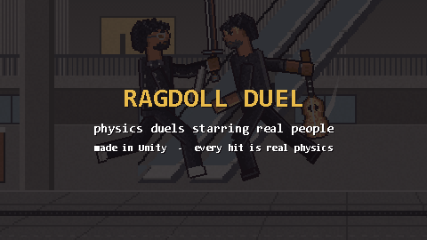
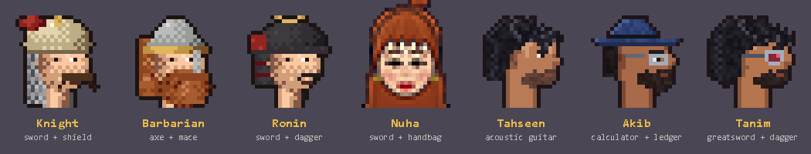
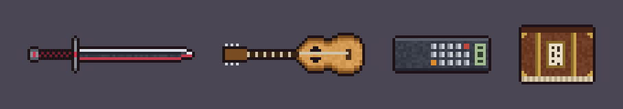
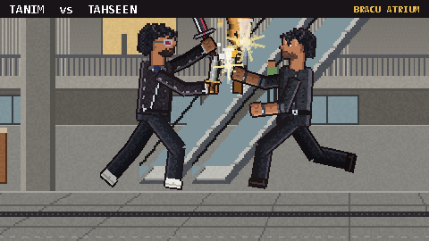
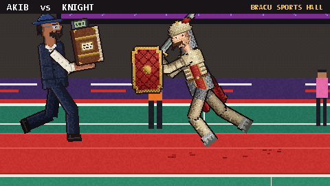
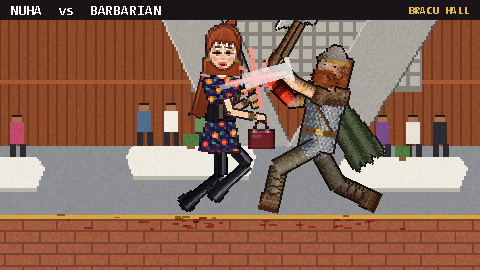

# Ragdoll Duel

**A 2D pixel-art physics brawler where your friends beat each other up with greatswords, guitars and calculators — on your own university campus.**

Every fighter is a real physics ragdoll. Every hand swings on its own. Every hit lands as hard as it actually hit.

---

## Why it's fun

- **Nothing is animated, everything is simulated.** Fighters are ragdolls held up by muscles (joint motors). Swing too hard and you wobble; take a big hit and you fold.
- **Two hands, two weapons, two buttons.** Your left and right hand act separately: chop with one, block with the other, or swing both.
- **Hits are physics, not hitboxes on a timer.** Damage comes from the real impulse at the moment of contact. A slow brush does almost nothing; a full-arc overhead to the head does a lot.
- **Armour that breaks.** Plate, mail and leather soak blows and wear down per body part (head, torso, arms, legs) until they shatter — then that spot bleeds.
- **Stamina, knockdowns and fainting.** Spam swings and you run dry and faint; get tipped over and you have to scramble back up.
- **The cast is real.** Knight, Barbarian and Ronin are joined by the developer's friends, drawn pixel by pixel from their photos.
- **Fair fights.** Easy and Normal give you a clear edge (you take less damage, deal more, and have narrower hitboxes); Hard is close to an even duel.

## The roster

| Fighter | Fights with | Style |
|---|---|---|
| **Knight** | sword + shield | full plate; raise the shield and blades bounce off |
| **Barbarian** | axe + mace | heavy hitter with two weapons and 120 health |
| **Ronin** | sword + dagger | lacquered plate on head and chest, two blades |
| **Nuha** | sword + handbag | quick on her feet; the bag swings along |
| **Tahseen** | acoustic guitar | strums a chord every time it connects |
| **Akib** | calculator + ledger | the accountant: clubs with a giant calculator, blocks with the books |
| **Tanim** | greatsword + dagger | the strongest — leather biker jacket, red-tinted shades, 125 health |

New weapons in this update:

## The arenas

Three new stages recreated from **BRAC University**'s campus, plus the original Forest Road.

| BRACU Atrium | BRACU Sports Hall | BRACU Hall |
|---|---|---|
|  |  |  |
| Steel louvre screens, criss-crossing escalators, students passing by | Duel on the red cricket pitch while the crowd watches | Giant V-shaped concrete beams, wood walls, an audience at round tables |

## Controls

| Action | Keyboard | On-screen (touch / mouse) | Gamepad |
|---|---|---|---|
| Right hand: swing (or block with a shield) | `J` (hold = keep swinging) | **R** | right trigger |
| Left hand: swing / block | `K` | **L** | left trigger |
| Step back / forward | `A` / `D` | **<** / **>** | d-pad |
| Jump | `Space` / `W` | **JUMP** | A |
| Lunge | `Shift` | double-tap | B |
| Aim a hand freely | hold left / right mouse button | drag | sticks |
| Restart / menu | `R` / `Esc` | | |

Extras: `H` shows hitboxes, `B` cycles blood (off / low / normal), `F3` logs every hit.

## Play it

1. Install **Unity 6000.6.6f1** (URP) through Unity Hub.
2. Clone this repo and open the folder as a project.
3. Open `Assets/Game/Scenes/Arena.unity` and press **Play**.
4. Pick your fighter, opponent, arena and difficulty — then fight. Best of three.

## Put yourself in the game

Every character and arena here was made from photos. The recipe is written down so anyone (or Claude) can repeat it:

- **[Ragdoll Style Guide](docs/Ragdoll_Style_Guide.md)** — what to take from a photo, part sizes and joints, the pixel-art style, and a ready-to-paste prompt.
- `SourceArt/<Name>/sprites.ps1` — each fighter is drawn as text rows of pixels and rendered with `SourceArt/tools/PixelMap.ps1`, so a new haircut is a one-line change.
- `SourceArt/Arenas/*.ps1` — each arena is drawn in code with `SourceArt/tools/PixelScene.ps1`.
- In Claude Code: `/fighter-from-pics <Name> <photos>` makes the sprites, adds the fighter and tests it in fights.

## Under the hood

- **Data-driven:** fighters, weapons, arenas and AI difficulties are ScriptableObjects in `Assets/Game/Data`; gameplay never names a specific character.
- **Ragdoll:** HingeJoint2D motors, two-bone arm IK, a balance controller with muscle strength that drops when you're hit.
- **Combat:** impulse-based damage with per-body-part armour; combat raises events and the effects (blood, sparks, hit-stop, camera shake) only listen.
- **No downloaded assets:** all art is generated by scripts in `SourceArt/`, all sounds are synthesized at runtime (the guitar strum is a Karplus–Strong pluck).
- **AI:** reacts to a slightly delayed view of you (like a human would), manages stamina, punishes knockdowns, and blocks with whatever it's holding.

---

Inspired by the feel of 2D physics duel games such as *Bloody Bastards*. All characters, art and code here are original. Made with Unity.
